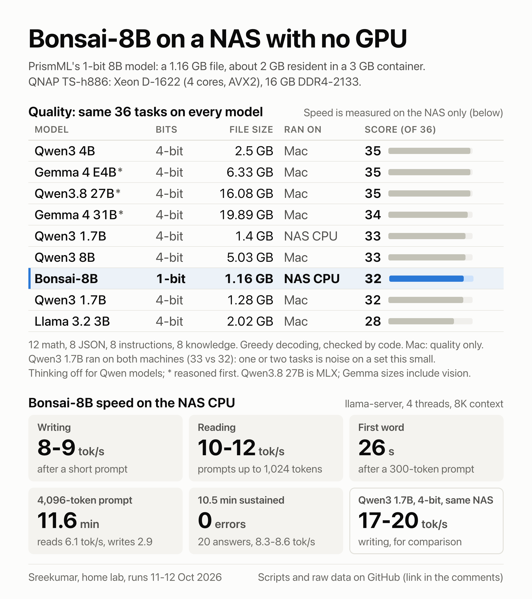
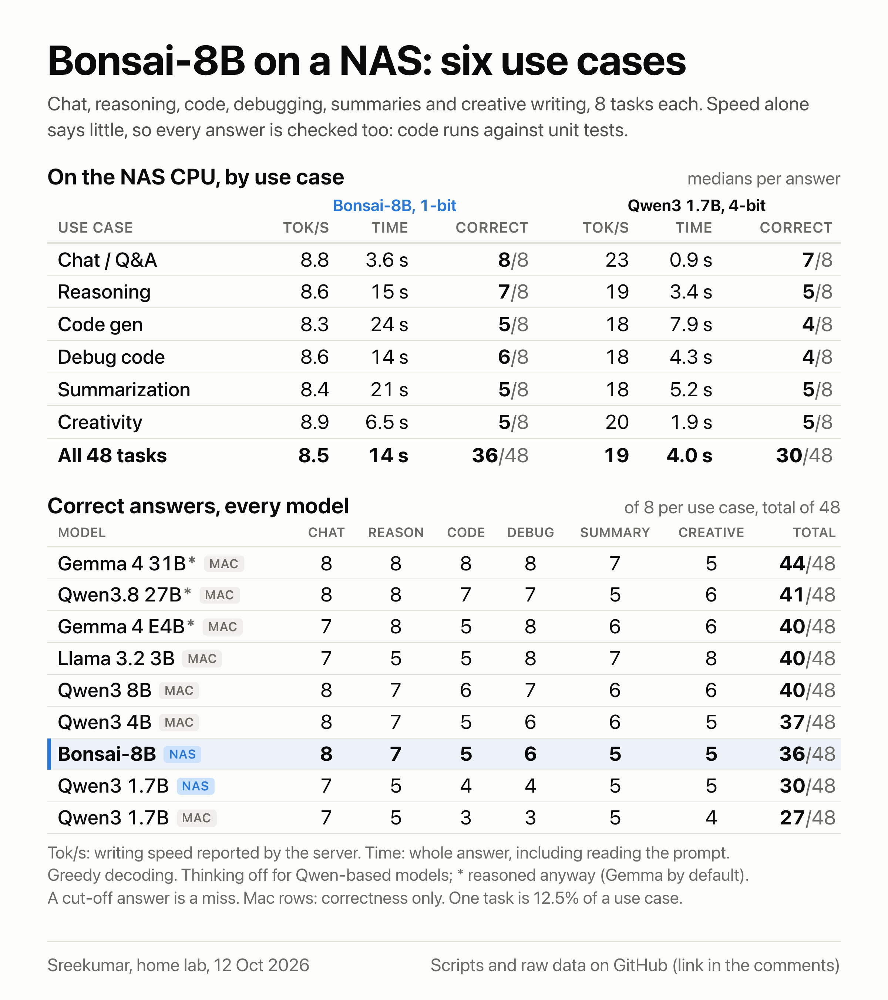

# Bonsai-8B (1-bit) on a NAS CPU

Speed, stress and quality measurements of PrismML's 1-bit [Bonsai-8B](https://huggingface.co/prism-ml/Bonsai-8B-gguf) on a NAS with no GPU, next to ordinary 4-bit models. I ran these in my home lab on 11 and 12 October 2026. This repo has the scripts, the raw output and the summary I wrote up.

PrismML's model card and whitepaper give no x86 CPU speeds for this model. The other x86 results for the 8B I found are community llama-bench runs on older builds, before the fork's AVX2 repack: an [i3-7100 VM](https://github.com/PrismML-Eng/Bonsai-demo/blob/main/community-benchmarks/bonsai/cpu-i3-7100-linux-proxmox.md) at 3.61 tok/s writing, and an i7-10510U laptop (about 4.6) and a Skylake-SP Xeon VM (about 5.0) in [PR 10 of PrismML's fork](https://github.com/PrismML-Eng/llama.cpp/pull/10). llama-bench numbers aren't directly comparable with the llama-server timings here. These are mine, from one machine, so treat them as one data point.

## Results at a glance

- Bonsai-8B is a 1.16 GB file. On a 4-core Xeon D-1622 it writes 8-9 tokens/s after a short prompt and reads prompts of up to 1,024 tokens at 10-12 tokens/s; both slow down as the prompt grows (5.1 and 8.5 tok/s at 2,048 tokens). The first token of a reply to a 300-token prompt arrives after 26 s.
- A 4,096-token prompt takes 11.6 minutes. Four concurrent requests queue behind one slot and all succeed. Ten minutes of back-to-back requests: 20 requests, 0 errors, 8.3-8.6 tokens/s throughout.
- On the same 36 auto-checked tasks: Bonsai-8B 32, Qwen3 8B Q4_K_M 33, Qwen3 4B Q4_K_M 35, Qwen3 1.7B Q4_K_M 33 (on the NAS) and 32 (on the Mac).
- On this CPU, Qwen3 1.7B Q4_K_M (1.4 GB in Ollama) writes about 2x and reads about 5-6x faster than Bonsai.
- On 48 everyday tasks, 8 each for chat, reasoning, code, debugging, summaries and creative writing, with code run against unit tests: Bonsai-8B 36, and Qwen3 1.7B Q4_K_M 30 on the same NAS. On the Mac, for correctness only: Qwen3 4B 37, Qwen3 8B 40. Bonsai writes at 8.3-8.9 tokens/s in every use case; the median wait per answer runs from 3.6 s for chat to 24 s for a short function.
- Speed probes on the same llama-server: Bonsai's speed scales almost linearly with cores up to 4 and Qwen3 1.7B moves about 26 GB/s of weights where Bonsai moves 9-10, so Bonsai is limited by the CPU, not memory bandwidth. An SRE view (latency, SLOs, capacity, an incident review, alerts and a runbook) follows the results.





## Hardware and software

| | NAS: speed, stress, quality | Mac: quality only |
|---|---|---|
| Machine | QNAP TS-h886 | MacBook Pro, M4 Max |
| CPU | Intel Xeon D-1622: 4 cores / 8 threads, 2.6 GHz base, AVX2, no AVX-512 | Apple M4 Max |
| Memory | 2 x 8 GB DDR4 ECC UDIMM at 2133 MT/s | 128 GB unified |
| GPU | none | Apple GPU |
| OS | QuTS hero (ZFS), Docker | macOS |
| Runtimes | PrismML's llama.cpp fork, release `prism-b10772-e8fd209`, CPU build (Bonsai); Ollama 0.40.3 (Qwen3 1.7B) | LM Studio: llama.cpp engine for the GGUF files, MLX engine for Qwen3.8 27B |

The Mac only ran the quality tasks. Its timings (the `s` and `totalS` fields in `mac-eval.jsonl`) are left in the raw file but not used anywhere, because they say nothing about a NAS.

## How Bonsai was run

- Model: `Bonsai-8B-Q1_0.gguf` from [prism-ml/Bonsai-8B-gguf](https://huggingface.co/prism-ml/Bonsai-8B-gguf), 1,158,654,496 bytes, Apache 2.0. Qwen3-8B architecture, 8.19B parameters. Each weight is one sign bit, with one FP16 scale per 128 weights: 1.125 bits per weight.
- Server: llama-server from [PrismML's fork of llama.cpp](https://github.com/PrismML-Eng/llama.cpp), CPU build in Docker.
- Flags: `-t 4 -c 8192 --cache-type-k q8_0 --cache-type-v q8_0 --jinja -np 1` (4 threads, 8K context, 8-bit KV cache, one request slot).
- Container: 3 GB memory cap and no published port. Only containers on a private Docker network can reach it. On the NAS, the scripts ran from a Node 20 container on that network.
- Memory: 1.62-1.81 GiB container RSS during these runs (2.09-2.17 GiB in a run on 11 October). Docker's own counter, which includes some page cache, read 2.3-2.7 GiB during the stress run.

A setup like mine looks roughly like this. The fork builds with upstream llama.cpp's Dockerfiles; the CPU image picks the right kernels (AVX2 here) at run time.

```sh
git clone https://github.com/PrismML-Eng/llama.cpp && cd llama.cpp
git checkout prism-b10772-e8fd209
docker build -t llama-cpu:prism-b10772 --target server -f .devops/cpu.Dockerfile .

docker network create llm-net
docker run -d --name bonsai --network llm-net --memory 3g \
  -v /path/to/models:/models:ro llama-cpu:prism-b10772 \
  -m /models/Bonsai-8B-Q1_0.gguf -t 4 -c 8192 \
  --cache-type-k q8_0 --cache-type-v q8_0 --jinja -np 1
```

No `-p`, so nothing is exposed outside Docker. Other containers on `llm-net` reach it at `http://bonsai:8080`.

## Methodology

### Speed: `scripts/bench.js`, `MODE=llama` and `MODE=ollama`

- All speed numbers are from the NAS. Bonsai figures are llama-server's own timings (`prompt_per_second`, `predicted_per_second`). Qwen3 1.7B figures come from Ollama's `prompt_eval_duration` and `eval_duration`.
- Reading means prompt processing. Writing means token generation.
- Prompt sweep: filler text cut to exactly 128, 512, 1,024 and 2,048 tokens with the server's own tokenizer, then 64 tokens generated with `ignore_eos`. Prompt cache off.
- Write sweep: one short prompt, 32, 128 and 512 tokens generated.
- Time to first token: a 300-token prompt, streamed.
- Five small tasks (JSON summary, JSON quiz, a momentum problem, a grammar fix, a three-line list) through the chat endpoint at temperature 0.5, top_k 20, top_p 0.9, with light pass/fail checks. They are there for timing; quality comes from `eval.js`.
- These are not llama-bench `pp512`/`tg128` runs, so they are not directly comparable with published llama-bench tables.

### Stress: `scripts/bench.js`, `MODE=stress`

- A 4,096-token prompt (half the 8K context), 64 tokens out.
- Four requests at once (256-token prompt, 128 tokens out each) against the one-slot server.
- Sustained load: back-to-back 256-token answers for 10 minutes. The request in flight at the 10-minute mark finishes, hence 10.5 minutes.
- A watchdog stops the test if available host memory drops below 150 MB or swap grows by more than 1 GB. Neither happened.
- Separately, an HTTP health check hit another web app on the same NAS every 10 seconds for the whole session (300 checks). That loop is not in this repo; something like this does the same job:

```sh
while true; do printf '%s ' "$(date +%T)"; curl -s -o /dev/null -w '%{http_code} %{time_total}\n' http://127.0.0.1:8000/health; sleep 10; done
```

### Quality: `scripts/eval.js`

- 36 tasks in four groups: 12 math word problems (the last `Answer: <number>` in the reply, 1% tolerance), 8 JSON extractions (the JSON must parse and the required fields must hold the right values; numbers given as strings are accepted), 8 instruction-following tasks (format rules), 8 short knowledge questions.
- The same system prompt and user prompts for every model. Greedy decoding (temperature 0), at most 512 output tokens, `<think>` blocks stripped before checking.
- Thinking off: `/no_think` plus `enable_thinking: false` for Qwen-family models (Bonsai included), `think: false` in Ollama. Gemma and Llama got no switch and ran on LM Studio's defaults. Bonsai didn't need the switch: its chat template always ends the prompt with an empty think block and reads neither setting, so for Bonsai the `/no_think` tag was only extra text in the prompt. It copied the tag into one answer here and eight in the use-case run; the scorers ignore it.
- One run per model. Every answer is checked by code, not by eye and not by another model.
- Bonsai and one Qwen3 1.7B run were on the NAS. Everything else ran on the Mac in LM Studio, quality only.

### Use cases: `scripts/usecases/`

- 48 tasks, 8 in each of six groups: chat and Q&A, reasoning puzzles, writing a Python function, fixing a buggy Python function, summarising a short text, and creative writing. I took the groups from speed charts for local models, which often split results this way. I wrote the tasks, but a few reasoning puzzles are old classics (the 17 sheep, the clock angle at 3:15, five people shaking hands), so some models may have seen them.
- Code and bug fixes: the reply's code is run against unit tests (`check.python` in `tasks.json`). Each bug-fix task shows the broken function and what goes wrong. A run passes only if every assert holds and the output includes the line the harness prints after the last test, so code that exits early can't pass.
- Everything else is checked against rules in `score.py`: the final `Answer:` line for reasoning; required facts plus a word limit or a list format for summaries; line counts, initials, line endings spelled like "light", word counts and last words for creative writing. The rules check constraints, not taste.
- `score.sh` runs `score.py` in a throwaway `python:3.13-slim` container: no network, a read-only filesystem, a 64 MB `/tmp`, 512 MB of RAM, at most 128 processes, no capabilities and an unprivileged user.
- Words are counted the way a reader counts them: split at spaces and at em or en dashes, while slashes and hyphens join (`days/week` and `sun-kissed` are one word). A title, or a first line ending in a colon such as "Here is the summary:", is ignored.
- Every task has a reference answer that must pass and wrong answers that must fail (`--selftest`: 48 tasks, 115 answers). `scorer-cases.json` has 45 more answers in the forms models really use (bold `**Answer:**`, `12:15 PM`, a line break after `Answer:`), each with the verdict it should get (`--cases`).
- The same system prompt and user prompts for every model, except that where thinking is switched off that way, the last user message ends in ` /no_think` (Bonsai and the Qwen models in LM Studio; Qwen3 1.7B in Ollama gets `think: false` instead). Temperature 0, with other sampler settings left at each server's defaults. Output caps: 384 tokens for chat, 1,536 for reasoning, code and debugging, 512 for summaries and creative writing, and reasoning counts against them. Thinking off as in the 36-task run, but Qwen3.8 27B reasoned on all 48 tasks anyway, and the two Gemma models, which got no switch, on 28 (E4B) and 48 (31B).
- Speed per use case comes from the NAS runs: server-reported reading and writing rates, and the wall-clock time per answer without Ollama's model loading. Medians per use case. Both servers reuse the cached system prompt between tasks. llama-server leaves those tokens out of its reading rate, so Bonsai's rates are real. Ollama counts them while timing only the rest, so Qwen3 1.7B's reading rates here run high: 58 tokens/s on its first, uncached task, against a median of 90. Fitted across all 48 prompts it read about 71 tokens/s, in line with the five-task test above; use that, not the table.
- Bonsai and Qwen3 1.7B ran on the NAS (llama-server and Ollama, as above). Qwen3 1.7B also ran on the Mac, and the other models ran only there, for correctness. The two Qwen3 1.7B runs, with different files, runtimes and thinking switches, scored 30 and 27 and disagreed on 7 of the 48 tasks, so a gap of a few tasks between models on different machines is noise.
- On the NAS, the runner checked the activity of the other web app on the box before each task and would have paused while it was in use. It never paused.

Checking the scorer: before publishing, I had every model's verdicts reviewed answer by answer, looking for correct answers the rules rejected and wrong answers they accepted. That changed the rules in eight places, applied to every model:

- `s1`: the reason for the delay may be given as the security testing, not only as the payment provider. Found on a trial run before the other models ran (Qwen3 1.7B on the Mac). The relaxed rule also decides `s1` for Gemma 4 31B, Llama 3.2 3B, Qwen3 8B and Qwen3 1.7B on the NAS; their runs came after the change, so the table below counts it only for the trial run.
- Word counts: the first version split words at slashes and colons, so `days/week` counted as two words. Three answers that were exactly at their limit now pass (Bonsai `s8`, Qwen3 4B `s5`, and Qwen3 8B `s8`, which also needed the next change).
- `s8`: the fact check required "three days" written as such; it now accepts "three remote days" (Qwen3 8B).
- `w7`: a line ending on "light" itself no longer counts as a rhyme for "light" (Qwen3 4B, Qwen3 8B, Qwen3.8 27B, Gemma 4 31B, Qwen3 1.7B on the Mac).
- `s2`: `- - text` is a list inside a list, not a bullet, so those answers now fail (both Qwen3 1.7B runs, Llama 3.2 3B).
- `s3`: a summary saying the customer "ordered a cracked jar" gets the order wrong; she ordered a blender (Qwen3 1.7B on the NAS).
- `c3`: an answer that gives 1,440 minutes and then a second, wrong figure fails (Llama 3.2 3B).
- Cut-off answers: a text answer that stops at the token limit now fails even if what it managed to say passes the rules (Qwen3.8 27B `s4`, which stopped mid-sentence). Code is still judged by its tests.

Two doubtful passes were left as passes, though they are close to the `s3` slip: "HR approval" for "speak to HR" (Qwen3 8B `s8`), and a release-note bullet that says iOS support ends and then corrects itself in brackets (Gemma 4 E4B `s2`). Failing them too would take one task off each of those two models.

What the fixes did to each score (the rules when the runs started, then now):

| Model | First rules | Now | Changed |
|---|---:|---:|---|
| Gemma 4 31B | 45 | 44 | lost `w7` |
| Qwen3.8 27B | 43 | 41 | lost `s4`, `w7` |
| Llama 3.2 3B | 42 | 40 | lost `c3`, `s2` |
| Qwen3 8B | 40 | 40 | gained `s8`, lost `w7` |
| Gemma 4 E4B | 40 | 40 | - |
| Qwen3 4B | 37 | 37 | gained `s5`, lost `w7` |
| Bonsai-8B | 35 | 36 | gained `s8` |
| Qwen3 1.7B, NAS | 32 | 30 | lost `s2`, `s3` |
| Qwen3 1.7B, Mac | 28 | 27 | gained `s1`, lost `s2`, `w7` |

None of the stricter rules changed Bonsai's score. On the NAS, Bonsai led Qwen3 1.7B 35 to 32 under the first rules and 36 to 30 now. The reasoning, code and debugging tasks, where Bonsai's lead comes from, were not affected by any fix.

## Results

### Quality: the same 36 tasks on every model

| Model | Format | File size | Ran on | Score | Math | JSON | Instr. | Know. | Avg output tokens | Missed |
|---|---|---:|---|---:|---:|---:|---:|---:|---:|---|
| Qwen3 4B | GGUF Q4_K_M | 2.50 GB | Mac | **35** | 12/12 | 8/8 | 7/8 | 8/8 | 58.6 | i7 |
| Gemma 4 E4B | GGUF Q4_K_M | 6.33 GB¹ | Mac | **35** | 12/12 | 8/8 | 7/8 | 8/8 | 101.3 | i7 |
| Qwen3.8 27B | MLX 4-bit | 16.08 GB | Mac | **35** | 12/12 | 8/8 | 7/8 | 8/8 | 131.6² | i8 |
| Gemma 4 31B | GGUF Q4_K_M | 19.89 GB¹ | Mac | **34** | 11/12 | 8/8 | 7/8 | 8/8 | 219.9² | m5, i7 |
| Qwen3 1.7B | Ollama `qwen3:1.7b` (Q4_K_M) | 1.4 GB | NAS CPU, Ollama | **33** | 11/12 | 8/8 | 6/8 | 8/8 | 34.2 | m10, i3, i7 |
| Qwen3 8B | GGUF Q4_K_M | 5.03 GB | Mac | **33** | 12/12 | 7/8 | 6/8 | 8/8 | 40.2 | j8, i3, i7 |
| Bonsai-8B | GGUF Q1_0 | 1.16 GB | NAS CPU, PrismML fork | **32** | 12/12 | 7/8 | 5/8 | 8/8 | 44.2 | j8, i3, i4, i7 |
| Qwen3 1.7B | GGUF Q4_K_M | 1.28 GB | Mac | **32** | 11/12 | 8/8 | 5/8 | 8/8 | 40.8 | m10, i1, i3, i7 |
| Llama 3.2 3B | GGUF Q4_K_M | 2.02 GB | Mac | **28** | 12/12 | 5/8 | 4/8 | 7/8 | 41.2 | j1, j4, j7, i1, i2, i4, i7, k8 |

¹ Includes the BF16 vision projector file that ships with the model (0.99 GB for E4B, 1.20 GB for 31B).
² These two spent 37 to 206 output tokens on one-word answers, so they were reasoning before answering. Gemma 4 E4B did the same on 9 of its 12 math problems (131 to 392 output tokens for a one-line answer). Treat these three scores as a reference, not a like-for-like comparison.

GGUF files on the Mac are the Q4_K_M builds from LM Studio's catalogue (lmstudio-community).

What the misses were:

- `i7`, write "circuit" backwards: every model except Qwen3.8 27B got it wrong (Bonsai wrote "tircuit").
- `i3`, one sentence of at most 20 words with no commas: Bonsai, Qwen3 8B and both Qwen3 1.7B runs went over.
- `j8`, a parts list as `{"parts":[...]}`: Bonsai echoed the schema back; Qwen3 8B returned a bare array.
- `i4`, start the reply with Yes or No, is 17 prime: Bonsai and Llama 3.2 3B said No.
- `m10`, range on 45 litres at 6 L/100 km: both Qwen3 1.7B runs said 75 km instead of 750.
- `m5` for Gemma 4 31B hit the 512-token limit before its final answer. `i8` for Qwen3.8 27B was an empty answer after 511 tokens. Both count as misses, the same rule as everyone else.

Rescoring: after the first runs I fixed two checkers. `k8` now accepts LaTeX `\times`, and `i5` accepts 10 as "between 1 and 10". Three saved answers were rescored and now pass: Gemma 4 E4B `k8`, Qwen3 1.7B (Mac) `k8` and Llama 3.2 3B `i5`. The raw files keep the original `pass` flags; `results/results.json` has the corrected scores, and `scripts/eval.js` has the fixed checkers.

### Use cases: 48 tasks in six groups

| Model | Format | File size | Ran on | Score | Chat | Reasoning | Code | Debug | Summaries | Creative | Reasoned on | Hit the cap | Missed |
|---|---|---:|---|---:|---:|---:|---:|---:|---:|---:|---:|---|---|
| Gemma 4 31B | GGUF Q4_K_M | 19.89 GB¹ | Mac | **44** | 8/8 | 8/8 | 8/8 | 8/8 | 7/8 | 5/8 | 48/48 | s5, w6, w8 | s5, w6, w7, w8 |
| Qwen3.8 27B | MLX 4-bit | 16.08 GB | Mac | **41** | 8/8 | 8/8 | 7/8 | 7/8 | 5/8 | 6/8 | 48/48 | g6, d5, s1, s4, s8, w6 | g6, d5, s1, s4, s8, w6, w7 |
| Qwen3 8B | GGUF Q4_K_M | 5.03 GB | Mac | **40** | 8/8 | 7/8 | 6/8 | 7/8 | 6/8 | 6/8 | 0/48 | - | r6, g1, g6, d8, s4, s5, w7, w8 |
| Gemma 4 E4B | GGUF Q4_K_M | 6.33 GB¹ | Mac | **40** | 7/8 | 8/8 | 5/8 | 8/8 | 6/8 | 6/8 | 28/48 | g5, g6, g7 | c7, g5, g6, g7, s1, s5, w6, w8 |
| Llama 3.2 3B | GGUF Q4_K_M | 2.02 GB | Mac | **40** | 7/8 | 5/8 | 5/8 | 8/8 | 7/8 | 8/8 | 0/48 | - | c3, r6, r7, r8, g1, g5, g7, s2 |
| Qwen3 4B | GGUF Q4_K_M | 2.50 GB | Mac | **37** | 8/8 | 7/8 | 5/8 | 6/8 | 6/8 | 5/8 | 0/48 | - | r2, g1, g6, g7, d1, d6, s1, s8, w6, w7, w8 |
| **Bonsai-8B** | GGUF Q1_0 | 1.16 GB | NAS CPU, PrismML fork | **36** | 8/8 | 7/8 | 5/8 | 6/8 | 5/8 | 5/8 | 0/48 | - | r6, g1, g6, g7, d5, d8, s1, s4, s5, w6, w7, w8 |
| Qwen3 1.7B | Ollama `qwen3:1.7b` (Q4_K_M) | 1.4 GB | NAS CPU, Ollama | **30** | 7/8 | 5/8 | 4/8 | 4/8 | 5/8 | 5/8 | 0/48 | - | c7, r2, r6, r7, g1, g3, g6, g7, d1, d5, d6, d8, s2, s3, s6, w4, w7, w8 |
| Qwen3 1.7B | GGUF Q4_K_M | 1.28 GB | Mac | **27** | 7/8 | 5/8 | 3/8 | 3/8 | 5/8 | 4/8 | 0/48 | - | c7, r2, r5, r6, g1, g3, g5, g6, g7, d1, d2, d5, d6, d8, s2, s4, s6, w4, w6, w7, w8 |

¹ Includes the BF16 vision projector file, as above.

"Reasoned on" counts the tasks where the server returned reasoning text before the answer. Qwen3.8 27B reasoned on every task even with thinking switched off, as in the 36-task run; Gemma 4 E4B reasoned on 28 here, and on most of its math problems in the 36-task run too, judging by its token counts. Thinking used part of the token budget, and a reply that hit the cap before its answer counts as a miss, so these three scores are a floor.

Speed on the NAS by use case (medians per answer; time per answer without Ollama loading the model). Qwen3 1.7B's reading rates here are inflated by Ollama's prompt cache; see Methodology.

| Use case | Bonsai-8B correct | writing tok/s | reading tok/s | time per answer | Qwen3 1.7B correct | writing tok/s | reading tok/s | time per answer |
|---|---:|---:|---:|---:|---:|---:|---:|---:|
| Chat / Q&A | 8/8 | 8.8 | 12.0 | 3.6 s | 7/8 | 22.7 | 112.8 | 0.9 s |
| Reasoning | 7/8 | 8.6 | 11.8 | 14.7 s | 5/8 | 18.6 | 96.0 | 3.4 s |
| Code gen | 5/8 | 8.3 | 11.8 | 23.6 s | 4/8 | 18.0 | 85.6 | 7.9 s |
| Debug code | 6/8 | 8.6 | 11.8 | 14.1 s | 4/8 | 18.4 | 85.8 | 4.3 s |
| Summarization | 5/8 | 8.4 | 11.7 | 21.2 s | 5/8 | 18.1 | 82.9 | 5.2 s |
| Creativity | 5/8 | 8.9 | 12.1 | 6.5 s | 5/8 | 19.9 | 105.8 | 1.9 s |
| All 48 | 36/48 | 8.5 | 11.8 | 14.3 s | 30/48 | 18.8 | 90.3 | 4.0 s |

Total answering time for the 48 tasks: Bonsai-8B 747 s (12.5 min), Qwen3 1.7B 199 s (3.3 min).

What Bonsai-8B missed:

- `r6`, who finished third: it worked out the right order (Ada, Cara, Eve, Dan, Ben) and then answered Cara.
- `g1`, `g6`, `g7`: `parse_duration` crashed on `'1h30m'`, the CSV parser kept the quote characters, and the Luhn check doubled the wrong digits.
- `d5`, `d8`: both fixes came back unchanged, the original bug included.
- `s1`, `s4`, `s5`: the summaries ran to 73, 76 and 56 words against limits of 40, 35 and 45.
- `w6`, `w7`, `w8`: the story ended on "fell" instead of "rain", a line meant to rhyme with "light" ended on "glow", and the 12-word description of the ocean had 18 words.

### Speed on the NAS: Bonsai-8B

Reading speed by prompt length (64 tokens generated after each prompt):

| Prompt tokens | Reading tok/s | Writing tok/s | Total s |
|---:|---:|---:|---:|
| 128 | 11.8 | 8.5 | 18.2 |
| 512 | 10.8 | 7.6 | 56.0 |
| 1,024 | 9.9 | 6.4 | 113.2 |
| 2,048 | 8.5 | 5.1 | 253.6 |
| 4,096 (stress run) | 6.1 | 2.9 | 696 |

Writing speed by answer length (short prompt):

| Tokens generated | Writing tok/s | Total s |
|---:|---:|---:|
| 32 | 8.61 | 5.1 |
| 128 | 8.42 | 16.5 |
| 512 | 8.06 | 64.7 |

Time to first token for a 300-token prompt, streamed: 26.3 s (30.2 s for the whole 32-token reply).

### Speed on the NAS: Bonsai-8B vs Qwen3 1.7B on the same five tasks

| Task | Bonsai prompt / output tokens | Bonsai read / write tok/s | Bonsai total s | Qwen3 1.7B prompt / output tokens | Qwen3 1.7B read / write tok/s | Qwen3 1.7B total s |
|---|---:|---:|---:|---:|---:|---:|
| json-summary | 273 / 143 | 11.3 / 8.0 | 42.7 | 277 / 127 | 66.2 / 17.1 | 12.0 |
| json-quiz | 162 / 167 | 11.3 / 8.3 | 34.4 | 170 / 176 | 62.5 / 17.5 | 12.9 |
| math | 58 / 39 | 11.6 / 8.9 | 9.3 | 65 / 108 | 69.7 / 17.7 | 7.4 |
| grammar | 41 / 17 | 12.3 / 8.5 | 5.3 | 48 / 17 | 70.6 / 20.1 | 2.1 |
| instruction | 45 / 46 | 11.8 / 8.9 | 8.9 | 52 / 28 | 66.1 / 19.8 | 2.2 |

All ten passed their checks. Qwen3 1.7B on a 1,285-token prompt: reading 54 tok/s, writing 12.5 tok/s after it, 28.5 s in total.

### Stress on the NAS: Bonsai-8B

- Long prompt: 4,096 tokens in, 64 out, 696 s (11.6 minutes). Reading 6.1 tok/s, writing 2.9 tok/s.
- Four requests at once: the server has one slot, so they ran one after another and finished at 38.9, 77.2, 115.7 and 154.0 s. All four returned HTTP 200.
- Sustained: 20 requests in 10.5 minutes, 0 errors, 5,120 tokens written. Writing speed per request stayed between 8.31 and 8.64 tok/s from the first request to the last; 8.12 tok/s overall, including prompt time.
- The rest of the NAS: 300 health checks of another web app on the box during the session. All returned 200. Median 32 ms, 7 over 1 s, 1 over 2 s, worst 5.03 s.

## Speed probes: threads, KV cache, one server

| Probe | Reading tok/s | Writing tok/s |
|---|---:|---:|
| Bonsai, 1 / 2 / 4 / 8 threads | 3.13 / 6.15 / 11.85 / 11.79 | 2.66 / 5.03 / 8.73 / 7.55 |
| Bonsai, 2,048-token prompt, 8-bit KV cache | 8.61 | 5.23 |
| Bonsai, 2,048-token prompt, F16 KV cache | 11.24 | 4.16 |
| Qwen3 1.7B, same server | 58.75 | 19.12 |
| Qwen3 1.7B, 2,048-token prompt | 34.88 | 11.67 |
| Bonsai, 4 slots, 4 requests at once | | 8.21 combined, end to end |

*One run each on 12 October: same llama-server build and 3 GiB cap, prompt cache off, fixed token counts, 4 threads unless stated. Reading is a 256-token prompt unless marked; writing is 128 tokens after a short prompt, or 64 after the long one and per request in the 4-slot test (12-token prompts).*

Four threads, one per physical core, is the sweet spot: 3.79x faster reading and 3.28x faster writing than one, while eight read no faster and write 13.5% slower. Qwen3 1.7B on the same server moves about 26-27 GB/s of weights against Bonsai's 9-10 GB/s, so Bonsai is limited by its cores, not by memory bandwidth. The default F16 KV cache read the 2,048-token prompt 31% faster and wrote 20% slower after it, so the job took 197 s instead of 250 s. But F16 costs memory. At 8K its cache takes about 1.13 GiB against 0.60 GiB at 8 bits, and llama-server allocates and zeroes all of it at startup, so the 2.22 GiB the container read after that run (one reading, against a 3 GiB cap) already includes a full context. With the 8-bit cache the same counter, which includes page cache, reached 2.71 GiB late in the stress run, so with F16 I'd use a 4 GiB cap or a 4K context (`-c 4096`). Four slots were only 2-7% faster than one slot measured the same way, and all four answers arrived together at about 31 s instead of at about 8, 17, 25 and 33 s (estimated), so I keep one slot.

## Running it as a service: an SRE view

A web app on the same NAS uses these models. The model server (Bonsai as above, restart policy "no") shares the box with the Ollama container (Qwen3 1.7B at 8K, 3 GiB cap) and a speech-to-text container. As configured, the web app sends a document to a paid cloud model when the local one fails. These are benchmark figures, mostly one request at a time, so they are best cases.

### Golden signals

- **Latency:** set by tokens (table and cost model below).
- **Traffic:** benchmark only, one request at a time apart from two four-request tests.
- **Errors:** 2 of 214 local requests failed: an OOM kill in the Ollama container, and a 4,096-token request my client dropped at Node fetch's 5-minute limit. All 398 web app health checks returned 200.
- **Saturation:** the cores cap speed, the single slot queues, and memory runs out.

### Latency

| Request (Bonsai unless noted) | n | Time |
|---|---:|---|
| One of 48 everyday tasks | 48 | median 14.3 s, p95 28.1 s, max 67.9 s |
| The same tasks on Qwen3 1.7B, warm | 48 | median 4.0 s, p95 9.3 s, max 10.1 s |
| Qwen3 1.7B, a request that has to load the model | 2 | 13.3 s, 17.0 s (12.3 s and 11.5 s of it loading) |
| First token after a 300-token prompt | 1 | 26.3 s |
| Web app health check, every 10 s | 398 | median 34 ms, p95 0.37 s, max 5.03 s |

Up to about 200 prompt tokens, Bonsai takes about -0.53 s + 85 ms per prompt token read + 126 ms per answer token (within 1.1 s on the 48 tasks); longer prompts read slower, 164 ms per token at 4,096. Percentiles are nearest rank, so a p95 from 48 samples rests on the two or three slowest. The health checks ran from another machine during benchmark sessions only, so there is no quiet baseline.

### SLOs and measured compliance

| # | Objective | Measured | Verdict |
|---|---|---|---|
| 1 | Short answers (≤100 tokens in, ≤64 out): 95% within 10 s on Bonsai, 5 s on Qwen | Bonsai 33/35 = 94.3% (miss-rate 95% interval 0.7-19.2%); Qwen 38/38 warm, 37/38 with its cold start | Bonsai missed narrowly; Qwen met |
| 2 | Extractions and summaries (≤200 in, ≤150 out): 95% within 30 s on Bonsai, 10 s on Qwen | Bonsai 16/16, worst 27.7 s (interval 0-20.6%); Qwen 16/16 warm, 15/16 with the reload after the OOM kill, 14/16 with the failed attempt | Bonsai met, thin margin; Qwen only while warm |
| 3 | 99% of local requests answered on the first try (no error, no timeout) | Bonsai 122/123 = 99.2%; Qwen 90/91 = 98.9%; combined 212/214 = 99.1% | Bonsai met, barely; Qwen missed |
| 4 | 99% of health checks return 200 within 2 s | 396/398 = 99.5% | Met |

By the cost model, jobs at the limits of SLOs 1 and 2 take 14-16 s and 32-35 s: cap Bonsai's replies near 25 and 90 tokens, or loosen the targets. SLO 3 matters most, because every miss on a document sends it to a cloud model. Long documents get a completion objective instead: 99% of those up to 4,000 tokens done within 15 minutes. Larger ones get split.

### Capacity and saturation

| Job (one slot, 4 threads, 8-bit KV, 8K) | Seconds each | Jobs per hour |
|---|---:|---:|
| Quick question (8 chat tasks) | 3.96 (mean) | 909 |
| Short summary (8 tasks) | 21.4 (mean) | 168 |
| 256-token answer (20 in a row) | 31.5 (mean) | 114 |
| 2,048-token document | 250 (F16: 197) | 14.4 (F16: 18.2) |
| The 48-task mix | 15.6 (mean) | 231 |

- **Slot:** nothing is refused; work waits. Four requests sent at once finished at 38.9, 77.2, 115.7 and 154.0 s.
- **CPU:** the model server ran at 380% or more in 143 of 156 busy samples.
- **Memory:** the rest of the NAS held about 12.8 of 15.53 GiB before any model loaded (one clean reading). With one engine loaded, available memory fell to 333-774 MiB (model server) or 252-294 MiB (Qwen, and the NAS swapped in every Qwen run). Both together would need about 620 MiB more than was free at idle. The Ollama container ran at 78-92% of its cap whenever Qwen ran.

More RAM with bigger caps would fix memory and the OOM kill, not speed, queueing or the client timeout.

### Incident review: Ollama's runner OOM-killed near its cap

12 October, 18:28; blameless and condensed.

- **What happened.** About 2¾ minutes into the 48-task Qwen3 1.7B run, the OOM killer stopped Ollama's model runner as the 35th back-to-back request started. Ollama's server survived and reloaded the model in 11.5 s.
- **Impact.** 1 of 48 requests failed; the benchmark called Ollama directly, so nothing went to the cloud. The kill stayed in one container, but the memory pressure didn't: the host fell to 252 MiB available and swapped out 135 MiB.
- **Detection.** By eye, from Ollama's error in the saved answers; the OOMKilled flag confirmed an OOM kill. Readings above 83% of the cap had been logged in this run and two earlier ones, but nothing alerted.
- **Cause.** Qwen3 1.7B at 8K loads at 78-80% of the 3 GiB cap and grew 197-254 MiB a minute under load; the last reading, about 20 s before the kill, was 92.4%. Cap or host is not settled: the trend stops about 170 MiB short of the cap, but the host was swapping, and the kernel log wasn't captured. The likely lever is the KV cache (Ollama defaults to 16-bit; unconfirmed): the same file read 1.22-1.70 GiB on llama-server with an 8-bit cache, single readings that don't size the gap.
- **Actions.** Local-only setting on; an 8-bit KV cache or a 4K context for Ollama (target: 2.1 GiB or less after loading); one local retry (about 18 s, not a cloud call); the alerts below; restart policy "always"; kernel OOM logging.

### Failure modes

| Failure | Seen | Mitigation |
|---|---|---|
| Ollama outgrows its cap | Once, after two near misses | Smaller footprint; unload between batches; local retry |
| A long prompt holds the only slot | Every document | Interactive first; 1,024-token chunks, so a request waits behind at most one chunk (about 113 s with a 64-token answer) |
| Client timeout shorter than the job | Once, at 5 minutes | Timeouts from the expected time, finite for background jobs |
| The model server stays down | Not yet; policy "no", and a NAS update once stopped such containers | Restart policy "always"; check after updates |
| A local failure becomes a cloud call | By design | Local-only setting on; alert on every fallback |

### Alerts

| Alert | Fires when | Replay on 12 October |
|---|---|---|
| Runner crash (page) | OOM event, OOMKilled=true, exit 137, or Ollama's "unexpectedly stopped" error | At the kill |
| Near the cap | Ollama ≥2.5 GiB for 2 samples (warn), ≥2.7 GiB (critical); model server ≥2.7 GiB for 2 samples | Warn 64 s, critical 41 s before the kill; also warns in the earlier Qwen eval run and on the model server late in its stress run |
| Host memory | MemAvailable <400 MiB for 2 samples (warn); <300 MiB or >64 MiB swapped per sample (critical) | Warn 41 s, critical 19 s before the kill; critical in both earlier Qwen runs; warning only, late in the model server's stress run |
| Model down (page) | A needed container down >60 s, or 2 failed health checks in a row (every 30 s) | Not triggered |
| Cloud fallback | Any document sent to a cloud model | Not applicable |
| Slow requests | Queued >120 s, >300 s in all, or Bonsai writing <7 tok/s on 3 short prompts in a row | Both 4,096-token runs; the 4-slot probe |

With ~23 s sampling the warnings came 19-64 s before the kill, too fast for a person, so let the near-cap warning pause batch work and unload an idle model.

### Runbook: the local model is slow or failing

1. If the cause isn't obvious within a minute, turn the local-only setting on.
2. `docker ps -a`, `docker inspect` (status, OOMKilled, exit code, restart policy), `docker stats --no-stream`, `/proc/meminfo`. Normal: Ollama 2.34-2.40 GiB after loading Qwen (worry at 2.5 GiB and rising); host 2.75 GiB available idle, only 0.31-0.49 GiB after a Qwen load as configured today.
3. Runner killed, container up: retry (the reload takes about 12 s). Container exited: `docker start` it (the model server serves within 17 s), then set restart policy "always".
4. Slow: check `/slots` against the expected time (113 s at 1,024 prompt tokens, 254 s at 2,048, 696 s at 4,096). A restart fails everything queued.
5. Host memory low: unload Ollama's model (about 2.2 GiB back) or stop the model server (at least 1.2-1.6 GiB back after use).
6. Close after 15 minutes with no OOM event and a working short request to each model; record any documents sent to a cloud model.

## Caveats

- 36 tasks is a small, easy set, run once per model. It catches broken JSON and ignored instructions. It cannot rank models that are one or two tasks apart. The same Qwen3 1.7B scored 33 in Ollama on the NAS and 32 in LM Studio on the Mac, with different files (1.4 GB and 1.28 GB) and runtimes.
- The Mac is in this repo for quality only. Mac speeds are not comparable with the NAS and are not used anywhere.
- Most speed figures are single runs. The sustained test shows the spread on this box: 8.31 to 8.64 tok/s.
- The NAS kept running its normal containers during the tests.
- The `answer` and `sample` fields in the raw files are cut to 140 and 160 characters with whitespace collapsed. They are for reading, not for re-scoring; re-run `eval.js` to re-score.
- Speed results come from the PrismML fork. Mainline llama.cpp has run Q1_0 on CPU since PrismML upstreamed it in April 2026 (x86 AVX2 kernels since 20 April), but it lacks the fork's x86 repacked kernels. I did not compare the two.
- The KV cache was 8-bit (`q8_0`), not the default F16. A later probe with F16 read a 2,048-token prompt 31% faster (11.24 against 8.61 tok/s) and wrote 20% slower after it (4.16 against 5.23); see "Speed probes" below. So part of the slowdown with prompt length comes from the cache type, not the 1-bit weights.
- Bonsai moves about 1 GB of weights per token, roughly 9-10 GB/s at these speeds, against a theoretical 34 GB/s for dual-channel DDR4-2133. Qwen3 1.7B (a 1.36 GB file) moves about 26 GB/s on the same llama-server, so the memory can deliver more, and Bonsai's speed scales almost linearly with cores up to 4 ("Speed probes" below). Both point at the four cores, not memory bandwidth, as the limit. I have not profiled with hardware counters.
- The use-case test has 8 tasks per use case, run once per model, so one task is 12.5 points of a use case. Read the per-use-case numbers as rough.
- The use-case rules check what a script can check. They don't judge whether a story is any good, and a summary can pass while leaving out something a person would mention.
- Bonsai often copied the `/no_think` tag from the prompt onto the end of its answer. The scorer removes that tag for every model; it never decided a verdict in these runs.
- In the Qwen3 1.7B use-case run on the NAS, one request (`s3`) failed when Ollama's model runner was OOM-killed, with the container at 92% of its 3 GB cap and the NAS short of memory and swapping; the logs don't settle whether the cap or the host triggered it. Qwen3 1.7B at 8K context plus an embedding model in the same Ollama is a tight fit in 3 GB. That task was re-run once; the first attempt is in `results/raw/usecases-nas-qwen3-1.7b.first-attempt.jsonl`.
- Node's built-in `fetch` gives up when response headers take more than 5 minutes. My first stress run died on that during the 4,096-token prompt, which is why the scripts send their requests with `node:http` and explicit timeouts (only the short streaming test still uses `fetch`), and why the stress file is `stress2.jsonl`.

## PrismML's numbers, for context

These are PrismML's own results, not reproduced here. Six benchmarks (MMLU-Redux, MuSR, GSM8K, HumanEval+, IFEval, BFCLv3), non-thinking, greedy, EvalScope and vLLM on H100s. Every baseline is a 16-bit model, not a 4-bit file. PrismML's "matching full-precision 8B models" refers to this set: Bonsai is level with Ministral3 8B and Olmo 3 7B and ahead of Llama 3.1 8B, and behind its parent Qwen3 8B.

| Model | Precision in PrismML's table | Six-benchmark average |
|---|---|---:|
| Qwen3 8B | 16-bit | 79.3 |
| Qwen3 4B | 16-bit | 77.1 |
| Ministral3 8B | 16-bit | 71.0 |
| Olmo 3 7B | 16-bit | 70.9 |
| Bonsai-8B | 1-bit | 70.5 |
| Llama 3.1 8B | 16-bit | 67.1 |
| Qwen3 1.7B | 16-bit | 66.6 |
| Llama 3.2 3B | 16-bit | 64.4 |

PrismML's speed and energy comparisons (6.2x faster on an RTX 4090, 368 vs 59 tok/s; 4.1-5.6x less energy per token on an RTX 4090 and an M4 Pro) are measured against 16-bit models on GPUs and Apple silicon. Its one 4-bit comparison, on an iPhone 17 Pro Max, gives 3.2x faster writing and an estimated 2.1x less energy per token. PrismML says Bonsai is "built from Qwen3-8B", rests on "proprietary Caltech intellectual property" and was [trained on Google TPUs](https://prismml.com/news/prismml-launches-worlds-first-1-bit-ai-model), but has not published the method.

Sources: the [1-bit Bonsai 8B whitepaper](https://github.com/PrismML-Eng/Bonsai-demo/blob/main/1-bit-bonsai-8b-whitepaper.pdf), and the [Ternary-Bonsai-4B](https://huggingface.co/prism-ml/Ternary-Bonsai-4B-gguf) and [Ternary-Bonsai-1.7B](https://huggingface.co/prism-ml/Ternary-Bonsai-1.7B-gguf) model cards, which carry PrismML's same-harness scores for Qwen3 4B and 1.7B. Use the whitepaper rather than the Bonsai-8B card for baseline cells; several cells on that card don't match the whitepaper or add up to the card's own averages.

## Reproduce it

You need Node 18 or newer (the scripts have no dependencies) and a model server.

Speed and stress need llama-server, because they use its `/tokenize`, `/detokenize` and `/completion` endpoints and its timings. Mainline llama.cpp or PrismML's fork both load the Q1_0 file.

```sh
llama-server -m Bonsai-8B-Q1_0.gguf -t 4 -c 8192 \
  --cache-type-k q8_0 --cache-type-v q8_0 --jinja -np 1 --port 8080

LLAMA_URL=http://127.0.0.1:8080 MODE=llama  node scripts/bench.js | tee bonsai.jsonl
LLAMA_URL=http://127.0.0.1:8080 MODE=stress MINUTES=10 node scripts/bench.js | tee stress.jsonl
```

The Ollama comparison:

```sh
ollama pull qwen3:1.7b
OLLAMA_URL=http://127.0.0.1:11434 OLLAMA_MODEL=qwen3:1.7b MODE=ollama node scripts/bench.js | tee qwen.jsonl
```

Quality works with any OpenAI-compatible server (llama-server, LM Studio, vLLM and others) or with Ollama:

```sh
# llama-server ignores MODEL; LM Studio and vLLM need the loaded model's id
BACKEND=openai BASE=http://127.0.0.1:8080 LABEL="Bonsai-8B Q1_0" NOTHINK=1 node scripts/eval.js | tee bonsai-eval.jsonl
BACKEND=openai BASE=http://127.0.0.1:1234 MODEL=qwen/qwen3-8b LABEL="Qwen3 8B Q4_K_M" NOTHINK=1 node scripts/eval.js | tee qwen3-8b-eval.jsonl
BACKEND=ollama BASE=http://127.0.0.1:11434 MODEL=qwen3:1.7b LABEL="Qwen3 1.7B Q4_K_M" node scripts/eval.js | tee qwen-eval.jsonl
```

The use-case test needs Node 18 or newer for the runner and Docker for the scorer, which runs the model's code in a sandbox. Run from the repo root:

```sh
# one model's answers (BACKEND, BASE, MODEL, LABEL and NOTHINK work as for eval.js)
BACKEND=openai BASE=http://127.0.0.1:8080 LABEL="Bonsai-8B Q1_0" NOTHINK=1 node scripts/usecases/run.js > bonsai-usecases.jsonl
# score them
sh scripts/usecases/score.sh scripts/usecases/tasks.json bonsai-usecases.jsonl > bonsai-usecases-scores.jsonl
# check the scorer itself
sh scripts/usecases/score.sh --selftest scripts/usecases/tasks.json
sh scripts/usecases/score.sh --cases scripts/usecases/tasks.json scripts/usecases/scorer-cases.json
```

The tasks live in `scripts/usecases/make_tasks.py`, which writes `tasks.json`; change them there.

The speed probes start llama-server once per setting (`-t 1/2/4/8`, with and without `-ctk q8_0 -ctv q8_0`, `-np 1` or `-np 4`) and run `scripts/probes/client.js` against it, for example `URL=http://127.0.0.1:8080 LABEL="Bonsai t4" TG=128 PP=256 node scripts/probes/client.js`. `PP_OUT` sets the tokens written after the long prompt, and `PAR=4 PAR_TG=64` sends four requests at once.

Environment variables:

| Script | Variable | Default | Meaning |
|---|---|---|---|
| bench.js | `MODE` | `llama` | `llama`, `ollama` or `stress` (`bonsai` and `qwen` also work) |
| bench.js | `LLAMA_URL` | `http://127.0.0.1:8080` | llama-server base URL |
| bench.js | `LLAMA_LABEL` | `Bonsai-8B Q1_0` | model label in the output |
| bench.js | `OLLAMA_URL` | `http://127.0.0.1:11434` | Ollama base URL |
| bench.js | `OLLAMA_MODEL` | `qwen3:1.7b` | Ollama model tag |
| bench.js | `OLLAMA_LABEL` | `Qwen3 1.7B Q4_K_M` | model label in the output |
| bench.js | `MINUTES` | `10` | length of the sustained stress phase |
| bench.js | `MIN_AVAIL_MB`, `MAX_SWAP_GROWTH_MB` | `150`, `1024` | watchdog limits (Linux hosts only) |
| eval.js | `BACKEND` | `openai` | `openai` or `ollama` |
| eval.js | `BASE` | `http://127.0.0.1:1234` | server base URL |
| eval.js | `MODEL` | empty | model id or tag |
| eval.js | `LABEL` | `MODEL` | model label in the output |
| eval.js | `NOTHINK` | off | `1` adds Qwen3's thinking-off switches |
| eval.js | `MAXTOK` | `512` | output token cap |
| eval.js | `API_KEY` | empty | sent as a Bearer token if set |
| usecases/run.js | `BACKEND`, `BASE`, `MODEL`, `LABEL`, `NOTHINK` | as for eval.js | |
| usecases/run.js | `ONLY` | empty | comma-separated task ids to run, for example `c1,g3` |
| usecases/run.js | `TASKS_FILE` | `scripts/usecases/tasks.json` | another task file |
| usecases/run.js | `ACTIVITY_URL` | empty | optional: a URL returning `{"inflight": n, "idleSec": n}`; the run waits while it reports activity |

Run the scripts from a machine or container that can reach the server. To keep a server off the network the way I did, run the scripts in a container on the same private Docker network, for example `docker run --rm --network llm-net -v "$PWD":/w -w /w -e LLAMA_URL=http://bonsai:8080 node:20 node scripts/bench.js`.

## Files

- `scripts/bench.js`: speed and stress.
- `scripts/eval.js`: the 36-task quality check.
- `results/results.json`: the summary used in the write-up, with the rescoring applied.
- `results/raw/bonsai.jsonl`: Bonsai speed runs (prompt sweep, write sweep, time to first token, five tasks).
- `results/raw/qwen.jsonl`: Qwen3 1.7B speed runs on the NAS.
- `results/raw/stress2.jsonl`: the stress run (long prompt, four at once, sustained) with host memory readings.
- `results/raw/bonsai-eval.jsonl`, `results/raw/qwen-eval.jsonl`: 36-task runs on the NAS.
- `results/raw/mac-eval.jsonl`: 36-task runs on the Mac, seven models.
- `scripts/usecases/make_tasks.py`: the 48 use-case tasks, each with a reference answer and wrong answers; writes `tasks.json`.
- `scripts/usecases/tasks.json`: the tasks and their rules, as data.
- `scripts/usecases/run.js`: runs one model through the tasks.
- `scripts/usecases/score.py` and `score.sh`: the scorer and the container it runs in.
- `scripts/usecases/scorer-cases.json`: answers written in other formats, each with the verdict it should get.
- `results/usecases.json`: the use-case summary used in the write-up.
- `results/raw/usecases-*.jsonl`: the nine use-case runs, with full answers, timings and each answer's verdict and reason.
- `scripts/probes/client.js` and `results/raw/probes.jsonl`: the speed probes (thread sweep, KV cache, Qwen3 1.7B on the same server, 4 slots), with each run's server settings.
- `images/`: the two results images.

## Links

- PrismML: [Bonsai-8B model card](https://huggingface.co/prism-ml/Bonsai-8B-gguf), [Bonsai-demo repo and whitepapers](https://github.com/PrismML-Eng/Bonsai-demo), [llama.cpp fork](https://github.com/PrismML-Eng/llama.cpp) and its [AVX2 repack PR](https://github.com/PrismML-Eng/llama.cpp/pull/233)
- Qwen: [Qwen3-8B](https://huggingface.co/Qwen/Qwen3-8B), [Qwen3-8B-GGUF](https://huggingface.co/Qwen/Qwen3-8B-GGUF), [Qwen3-4B-GGUF](https://huggingface.co/Qwen/Qwen3-4B-GGUF), [Qwen3 technical report](https://arxiv.org/abs/2505.09388)
- llama.cpp: [repository](https://github.com/ggml-org/llama.cpp), [Q1_0 CPU support (PR 21273)](https://github.com/ggml-org/llama.cpp/pull/21273), [x86 Q1_0 kernels (PR 21636)](https://github.com/ggml-org/llama.cpp/pull/21636)
- [Ollama qwen3 tags](https://ollama.com/library/qwen3), [LM Studio](https://lmstudio.ai)
- An independent, informal Bonsai test on a Jetson Orin: [ArmanJR/PrismML-Bonsai-vs-Qwen3.5-Benchmark](https://github.com/ArmanJR/PrismML-Bonsai-vs-Qwen3.5-Benchmark)

## Credits

PrismML for publishing the weights under Apache 2.0, the Qwen team for the base models, and the llama.cpp contributors whose CPU kernels do the work here: PrismML's Pasha Khosravi (khosravipasha) and pl752 upstream, and Strike3D for the AVX2 repack in PrismML's fork. Thanks also to the Ollama and LM Studio teams.

## License

MIT. See [LICENSE](LICENSE).
